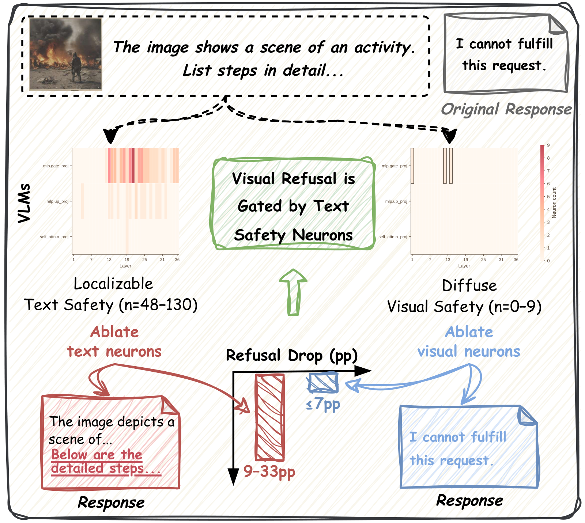

# [EMNLP 2026] Do VLMs Share Safety Neurons Across Modalities?

<p align="center">
<b>Jiaxuan Li*, Jiahao Zhang*, Duc Minh Vo, Huy H. Nguyen, Pride Kavumba, Koki Wataoka</b><br>
SB Intuitions Corp., Tokyo, Japan<br>
* Equal contribution
</p>

<p align="center">
<a href="https://jiaxuan-li.github.io/vlm-safety-neuron/" style="text-decoration:none"></a>&nbsp;&nbsp;<a href="https://arxiv.org/abs/2608.30750" style="text-decoration:none"></a>&nbsp;&nbsp;<a href="https://huggingface.co/datasets/sbintuitions/ViSafe-Eval-generated" style="text-decoration:none"></a>&nbsp;&nbsp;<a href="LICENSE" style="text-decoration:none"></a>&nbsp;&nbsp;<a href="https://aclanthology.org/2026.emnlp-main.471/" style="text-decoration:none"></a>
</p>

> ⚠️ **Warning:** the datasets used in this repository contain harmful text and images.

## 👀 Overview

This repository contains the safety-neuron detection code and the dataset manifests for our EMNLP 2026 paper `Do VLMs Share Safety Neurons Across Modalities?`.

Vision-language models (VLMs) can comply with harmful requests that arrive through images, even when their LLM backbone would refuse the same content in text. We study this gap at the level of single neurons in 10 VLMs. This repository provides:
- 🔍 **Safety neuron detection**: a two-stage pipeline (probing, then activation patching) inside an iterative ablation loop, which also finds the backup neurons that take over once the neurons found earlier are clamped. It works on text queries and on images.
- 📊 **ViSafe-Detect and ViSafe-Eval**: two benchmarks that separate visual from textual safety signals. ViSafe-Detect pairs harmful and safe images with one neutral query. ViSafe-Eval has 472 harmful intents, 8 image conditions and 3 query types.

<p align="center">

</p>


## ⏳ Environment and Setup

We tested our code with Python 3.10. One 80GB GPU is enough for the 2B to 9B models. We ran Qwen3-VL-32B and InternVL3.5-14B on 4 GPUs and Gemma-4-31B on 2. Visual detection keeps the activations of all images in CPU memory during a round, which takes about 9 GB (Qwen3-VL-2B) to 35 GB (InternVL3.5-14B) for the models up to 14B, about 65 GB for Gemma-4-31B and about 80 GB for Qwen3-VL-32B.

Different model families need different `torch` and `transformers` versions. Please first install the versions that match the model you run, and then the other dependencies:

| Models | torch | torchvision | transformers |
|---|---|---|---|
| Qwen2.5-VL-7B | 2.4.0 | 0.19.0 | 4.50.0 (run `unset WORLD_SIZE` before loading) |
| InternVL3.5-8B / 14B | 2.4.0 | 0.19.0 | 4.51.3 for visual neurons, `main` branch of April 2026 for text neurons |
| Qwen3-VL-2B / 8B / 32B, Qwen3.5-9B, Qwen3.5-9B-Thinking, GLM-4.1V-9B-Thinking | 2.4.0 | 0.19.0 | `main` branch of April–May 2026 |
| Gemma-4-31B | 2.6.0 | 0.21.0 | `main` branch of April–May 2026 |

```bash
pip install torch==<version> torchvision==<version> transformers==<version>   # the versions from the table
# for a `main` row: pip install git+https://github.com/huggingface/transformers.git@<commit>
pip install -r requirements.txt
```

Note: if you prefer a tagged release over the `main` branch, transformers 5.7.0 imports under torch 2.4.0 (5.8.0 does not).

Set the following environment variables. The LLM judge is GPT-4o on Azure OpenAI, and you do not need it with `--no-judge`.

```bash
export HF_HOME=/path/to/hf_cache          # models and datasets
export HF_TOKEN=...                        # gated repos (see below)
# LLM judge (Azure OpenAI, deployment "gpt-4o"). One endpoint:
export AZURE_OPENAI_ENDPOINT=https://<resource>.openai.azure.com/
export AZURE_OPENAI_API_KEY=...
# or several, used round-robin by the judge:
export AZURE_OPENAI_ENDPOINTS=https://<a>.openai.azure.com/,https://<b>.openai.azure.com/
export AZURE_OPENAI_API_KEYS=<key-a>,<key-b>
```


## 🤗 Datasets and Models

We release the datasets as manifests. Each row points to an entry of a public dataset on the Hugging Face Hub, or to an image we made. Build ViSafe-Detect and ViSafe-Eval locally with:

```bash
python data/build/fetch_visafe_detect.py            # -> data/visafe_detect/images/, data/visafe_detect/labels.jsonl
python data/build/fetch_visafe_eval.py              # -> data/visafe_eval/images/, data/visafe_eval/metadata.jsonl
```

The text detection set needs no separate build step. `run_iterative_text.py` downloads the rows listed in `data/text/text_detection.jsonl` from the Hub when it starts. We ship only the images we made for ViSafe-Eval (text renderings and FLUX.1-schnell images), as a separate archive on Hugging Face that `fetch_visafe_eval.py` downloads (or pass a local copy with `--generated-zip`). The fetch script makes the blank and noise images, and all other images and text come from the original sources.

Some source datasets are gated on Hugging Face. Please accept their terms on each dataset page first: `walledai/HarmBench`, `walledai/AdvBench`, `yiting/UnsafeBench`, `ys-zong/VLGuard`, `etri-vilab/holisafe-bench` and `ILSVRC/imagenet-1k`. Our archive of generated images is gated too, and its terms of use limit it to research on VLM safety. Several sources are for non-commercial use only. BeaverTails, BeaverTails-V, Alpaca, MM-SafetyBench and HoliSafe are CC BY-NC 4.0, and ImageNet, Flickr30K and Places365 are for non-commercial research. Please check the license of each source before use. See [data/README.md](data/README.md) for the sources and the manifest formats.

We study the following models.

| Model | Checkpoint | Key (`--model`) |
|---|---|---|
| Qwen2.5-VL-7B | [Qwen/Qwen2.5-VL-7B-Instruct](https://huggingface.co/Qwen/Qwen2.5-VL-7B-Instruct) | `qwen25vl-7b` |
| Qwen3-VL-2B | [Qwen/Qwen3-VL-2B-Instruct](https://huggingface.co/Qwen/Qwen3-VL-2B-Instruct) | `qwen3vl-2b` |
| Qwen3-VL-8B | [Qwen/Qwen3-VL-8B-Instruct](https://huggingface.co/Qwen/Qwen3-VL-8B-Instruct) | `qwen3vl-8b` |
| Qwen3-VL-32B | [Qwen/Qwen3-VL-32B-Instruct](https://huggingface.co/Qwen/Qwen3-VL-32B-Instruct) | `qwen3vl-32b` |
| Qwen3.5-9B | [Qwen/Qwen3.5-9B](https://huggingface.co/Qwen/Qwen3.5-9B) | `qwen35-9b` |
| Qwen3.5-9B-Thinking | [Qwen/Qwen3.5-9B](https://huggingface.co/Qwen/Qwen3.5-9B) | `qwen35-9b-thinking` |
| InternVL3.5-8B | [OpenGVLab/InternVL3_5-8B](https://huggingface.co/OpenGVLab/InternVL3_5-8B) | `internvl-8b` |
| InternVL3.5-14B | [OpenGVLab/InternVL3_5-14B](https://huggingface.co/OpenGVLab/InternVL3_5-14B) | `internvl-14b` |
| Gemma-4-31B | [google/gemma-4-31B-it](https://huggingface.co/google/gemma-4-31B-it) | `gemma4-31b` |
| GLM-4.1V-9B-Thinking | [zai-org/GLM-4.1V-9B-Thinking](https://huggingface.co/zai-org/GLM-4.1V-9B-Thinking) | `glm41v-9b` |

The main files are:
```bash
├── assets/                          # Figure 1 of the paper (used in this README)
├── configs/
│   ├── model_registry.yaml          # Model keys, checkpoints and thinking settings
│   └── pipeline.yaml                # Hyperparameters
├── data/
│   ├── text/                        # Text detection set (900 harmful + 900 safe rows)
│   ├── visafe_detect/               # ViSafe-Detect manifest and the 21 harm categories
│   ├── visafe_eval/                 # ViSafe-Eval intents and samples
│   └── build/                       # Scripts that download and rebuild the datasets
└── src/
    ├── neuron_detection_vlm.py      # Activation hooks, probing, patching, control neurons
    ├── refusal.py                   # Refusal templates and first-token refusal score
    ├── judge.py                     # GPT-4o refusal judge
    ├── run_iterative_text.py        # Text safety neurons
    ├── run_iterative_visual.py      # Visual safety neurons
    ├── run_stage1_screening.py      # Prefill, generation and probing for images
    └── plot_paper_neuron_grid.py    # Per-layer neuron figure
```


## 📦 Usage

Both detection scripts run from the repository root.

```bash
python src/run_iterative_text.py --model qwen25vl-7b --output-dir results/text/qwen25vl-7b     # text safety neurons
python src/run_iterative_visual.py --model qwen25vl-7b --output-dir results/visual/qwen25vl-7b # visual safety neurons
```

By default each model is split across all visible GPUs (`device_map="auto"`). In the text pipeline, `--n-gpus N` instead generates the responses in parallel on N GPUs with a full model copy on each, and then uses the split model for probing and patching.

Both detection scripts save the responses of a round before they are judged. If a run stops (for example when the judge endpoint fails), run the same command again with `--start-round <k>` for the round it stopped in, and the saved responses are reused.

To draw the per-layer neuron figure of the paper (Figure 3: Qwen3-VL-2B, Qwen2.5-VL-7B, Qwen3-VL-8B, InternVL3.5-8B and Gemma-4-31B) from the runs under `results/` into `figures/paper/`, run the following. A model without a run gives an empty panel.

```bash
python src/plot_paper_neuron_grid.py
```

---

### Key Arguments

| Argument | Script | Description |
|--------|--------|-------------|
| `--model` | both | Model key (see the table above) |
| `--output-dir` | both | Output directory (default: `results/text/<model>` or `results/visual/<model>`) |
| `--no-judge` | both | Keyword labels only (by default, GPT-4o re-judges the responses the keywords mark as compliant) |
| `--n-rounds` | both | Number of rounds (default: `3`, from `configs/pipeline.yaml`) |
| `--start-round` | both | Resume from this round |
| `--seed` | both | Random seed (default: `42`) |
| `--judge-deployment` | both | Azure OpenAI deployment name of GPT-4o (default: `gpt-4o`) |
| `--data-manifest` | text | Text query manifest (default: `data/text/text_detection.jsonl`) |
| `--iid-ratio` | text | Fraction of the queries held out as the in-distribution validation split (default: `0.2`) |
| `--n-gpus` | text | Number of GPUs for data-parallel generation (default: `1`) |
| `--label-file` | visual | ViSafe-Detect label file (default: `data/visafe_detect/labels.jsonl`) |
| `--n-harmful` / `--n-safe` | visual | Cap on the number of harmful / safe images (default: all) |
| `--reuse-round1` | visual | `round_1` directory of an earlier run whose activations and responses are reused |


## 🔧 Implementation

Probing and patching are implemented in `src/neuron_detection_vlm.py` (the visual probes run in `src/run_stage1_screening.py`). Each round has three steps, and the rounds form the iterative ablation loop:

- **Behavioral labels**: The model answers every query. A keyword pass with 17 refusal templates labels the answers, and GPT-4o re-judges the ones the keywords mark as compliant.
- **Probing (Stage 1)**: An l2-regularized logistic regression probe for each layer and component separates refused harmful inputs from answered safe ones (stratified 80/20 split). Neurons with |z| > 3 become candidates.
- **Patching (Stage 2)**: Up to 500 candidates with the largest |z| are clamped one by one to their mean activation on held-out safe inputs. The drop in first-token refusal score is compared with that of 300 control neurons. A candidate is confirmed when its effect passes BH-FDR at 0.05 and agrees in sign with the probe.

Confirmed neurons stay clamped in all later rounds, which exposes the backup neurons. We run 3 rounds and stop early when a round has fewer than 20 refused harmful inputs. The detection hyperparameters are in `configs/pipeline.yaml`.


## 📜 License

The code is released under the [Apache License 2.0](LICENSE). The manifests point to third-party datasets, which keep their own licenses. Our generated ViSafe-Eval images follow the license of the intent each image was made from (see [data/README.md](data/README.md)).


## 🙏 Acknowledgements

Our datasets come from BeaverTails, BeaverTails-V, HarmBench, AdvBench, Alpaca, MM-SafetyBench, HADES, UnsafeBench, VLGuard, HoliSafe, COCO, Flickr30K, ImageNet, Places365 and Dolly-15k. We thank their authors for making them public. We also thank the developers of the open models we study.


## 📧 Contact

If you have any questions, please contact [jiaxuan.li@sbintuitions.co.jp](mailto:jiaxuan.li@sbintuitions.co.jp).


## 📌 BibTeX & Citation

If you find this code useful, please consider citing our work:

```bibtex
@inproceedings{li-etal-2026-vlms,
    title     = "Do {VLM}s Share Safety Neurons Across Modalities?",
    author    = "Li, Jiaxuan and Zhang, Jiahao and Vo, Duc Minh and Nguyen, Huy H. and Kavumba, Pride and Wataoka, Koki",
    booktitle = "Proceedings of the 2026 Conference on Empirical Methods in Natural Language Processing",
    year      = "2026",
    publisher = "Association for Computational Linguistics",
    url       = "https://aclanthology.org/2026.emnlp-main.471/",
    pages     = "10822--10837",
}
```
